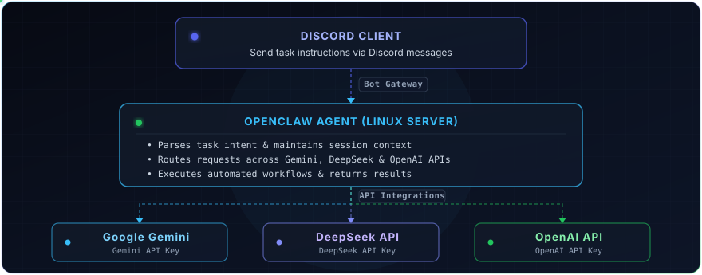

  

  
  
  
  

## ⚡ About Me

I'm **Muhammad Moiz**, a Class 10 student at **Hamza Army Public School** in Islamabad, Pakistan, focused on **AI Workflow Automation**, **Bot Engineering**, and **Rapid Full-Stack App Building** — open to freelance projects and remote opportunities.

- 🤖 **AI Automation & Agents**: Built a server-hosted Discord AI task agent with **OpenClaw** wired to **Gemini**, **DeepSeek**, and **OpenAI** APIs, plus **WhatsApp** & **Discord** automation bots.
- 💻 **Full-Stack & Desktop Apps**: Shipping web apps with **React**, **Next.js**, **Node.js**, **Express**, and **Firebase**, plus desktop apps with **Electron**.
- ⚡ **Python & CLI Tooling**: Building high-concurrency async CLI tools, segmented media downloaders, and OCR search utilities.
- 🛡️ **Cybersecurity Foundation**: Completed a 3-month Certified Ethical Hacking (CEH) course (Govt. of Punjab / Punjab HEC) and comfortable working in **Linux** environments.

## 🤖 Featured System: OpenClaw Discord AI Task Agent

> **Deployment:** Linux Server • **Interface:** Discord Messages • **Providers:** Gemini, DeepSeek & OpenAI APIs

A server-hosted AI automation agent built with **OpenClaw** that receives natural-language instructions directly in Discord and executes tasks on a live server using multi-provider LLM routing.

  

## 🚀 Flagship Projects

| Project | Summary | Stack | Repo |
| :--- | :--- | :--- | :---: |
| **Minecraft Bot Controller** | Multi-bot Minecraft automation controller with pathfinding, combat, inventory handling, web dashboard, and AI conversation routing. | Node.js • Mineflayer • Express • HTML/CSS | [View Code](https://github.com/Moiz-Genius/minecraft-bot-controller) |
| **Smart Video Downloader** | Multi-segmented video downloader (`yt-dlp` + HTTP Range) with stream muxing, frame extraction, and EasyOCR scene text search. | Python • yt-dlp • EasyOCR • Rich | [View Code](https://github.com/Moiz-Genius/smart-video-downloader) |
| **Muslims Browser** | Privacy-focused desktop web browser with hardware-accelerated Chromium flags, multi-tab BrowserViews, and native ad blocking. | Electron • Electron Forge • JavaScript | [View Code](https://github.com/Moiz-Genius/muslims-browser) |
| **SpeedTube (YouTube Client)** | Lightweight YouTube web client with a 30-minute in-memory Express caching backend and persistent iframe playback. | Node.js • Express 5 • Vanilla JS | [View Code](https://github.com/Moiz-Genius/youtube-clone) |
| **Pinterest Downloader CLI** | Async Python CLI to extract and download original-quality images, HD videos, and GIFs from Pinterest URLs and `pin.it` links. | Python • HTTPX • BeautifulSoup4 • Rich | [View Code](https://github.com/Moiz-Genius/pinterest-downloader) |
| **Wraith Agent Spec** | Full architectural blueprint and build specification for Wraith, a local-first CLI autonomous coding agent. | Architecture Spec • TypeScript • Node.js 20+ | [View Code](https://github.com/Moiz-Genius/wraith-spec) |

## 🛠️ Tech Stack & Tools

**AI & Automation**

  
  
  
  
  
  
  

**Full-Stack, Desktop & Cloud**

  
  
  
  
  
  

**Languages & Systems**

  
  
  
  
  
  

## 📜 Verified Certificates

| Credential | Issuer | Verification / ID |
| :--- | :--- | :--- |
| **1 Million Prompters** — Certificate of Completion | Dubai Future Foundation & Dubai Centre for Artificial Intelligence | [Verify Certificate](https://omp.dub.ai/certificate/nE4ZIVviYKeK) |
| **Certified Ethical Hacking (CEH)** — 3-Month Course Completion | Government of Punjab / Punjab HEC Initiative (17/03/2024) | ID: `00e0aa725c` |

## 📊 GitHub Stats

  

## 📫 Contact

- **Email:** [opgamermoiz@gmail.com](mailto:opgamermoiz@gmail.com)
- **LinkedIn:** [linkedin.com/in/muhammed-moiz-282302376](https://www.linkedin.com/in/muhammed-moiz-282302376)
- **Discord:** `devilytmoiz`
- **Location:** Islamabad, Pakistan